<a href="https://alitarraf.dev">
  
</a>

<p align="center">
  <a href="https://linkedin.com/in/ali-tarraf-730b9a171"><b>LinkedIn</b></a>
  &nbsp;&nbsp;/&nbsp;&nbsp;
  <a href="https://alitarraf.dev/ali-tarraf-resume.pdf">Résumé (PDF)</a>
  &nbsp;&nbsp;/&nbsp;&nbsp;
  <a href="https://alitarraf.dev">alitarraf.dev</a>
</p>

Five-plus years shipping SaaS platforms that outlive the sprint that made them. I own frontend architecture, the part nobody sees until it holds or doesn't: multi-tenant systems, SSR at scale, and design systems that survive six product teams pulling in six directions. Then I mentor the next engineer to do it without me.

```text
ali@field:~$ whoami

now        Senior Software Engineer at SoftMind
           SaaS ERP suite used by 1,500+ companies across 8 countries
led        a frontend team of 3 at Sowlutions, 50+ pull request reviews a month
owned      the frontend architecture of a multi-tenant platform for 50+ companies
worked     directly with the CEO and CTO on architecture and product strategy
uptime     5+ years shipping, remote teams in New York, Qatar and Canada
based      Beirut, Lebanon
speaks     Arabic (native), English (full professional), French (elementary)
```

### Scale

```text
ali@field:~$ scale

1,000,000+   users reached on a creator platform, worldwide
  120,000    users on a multi-tenant legal AI platform
      50+    companies served from a single codebase
        6    business modules consolidated into one application
```

### Impact



### How I work

**Boundaries before features.** Six business modules on one codebase only works if the seams are decided first. Tenants, domains, shared primitives: draw them, then ship inside them.

**The render path is a budget.** SSR with Nuxt 3, route-level code splitting, payload discipline. Every millisecond is spent on purpose, and measured after.

**Patterns are communication.** Singleton, Observer, Facade, higher-order components. They are how three developers agree on the shape of a thing without a meeting.

**Review is the architecture.** 50+ pull requests a month. Architecture that lives only in a diagram is a wish; architecture enforced at the diff is real.

### Skills

| | |
|---|---|
| **Frontend** | TypeScript, JavaScript, React, Next.js, Vue, Nuxt 3, Tailwind CSS, Ant Design, HTML5, CSS3 |
| **Backend** | Node.js, Express, NestJS, PostgreSQL, SQL, MongoDB, Socket.io |
| **DevOps & infra** | Docker, CI/CD, Nginx, Caddy, load balancers, Linux server management, deployments |
| **Architecture** | Frontend and software architecture, design patterns, SSR, multi-tenant SaaS, responsive and cross-browser |
| **Leadership** | Technical leadership, team mentoring, code review, technical decision-making, stakeholder management |
| **AI workflows** | AI-assisted architecture analysis, framework migration planning, custom agents and skills, integrations |
| **Tooling** | Git, GitHub, Jest, Postman, Google Analytics, Mixpanel, Agile / Scrum |

### Career

```text
ali@field:~$ work
                2021  2022  2023  2024  2025  2026
Codi Tech       ████                                    Full-Stack Developer (bootcamp)
Docclik            ███████                              Full-Stack Web Developer
Numbase Group            ████████                       Frontend Engineer
Skeldus                         ███████                 Frontend Engineer
Sowlutions                           ████████████       Senior Software Engineer, frontend lead
SoftMind                                        ████    Senior Software Engineer ◀ now
```

- **Sowlutions:** led a team of 3 across several SaaS products. Owned the architecture of a legal operations platform that consolidated 6 modules for 50+ companies and 120,000 users, and led the redesign of a creator platform with 1M+ users.
- **Skeldus:** built 13+ dashboards and reporting interfaces for a cybersecurity and compliance platform. Reliability up 25%, downtime and bugs down 15%.
- **Numbase Group:** built real-time chat and notifications with Socket.io, and replaced legacy patterns with a structured architecture that cut latency by 40%.
- **Docclik:** built live appointment scheduling for a healthcare platform used by thousands of practitioners across Canada. Load time down 40%, retention up 20%.

### Education and community

**B.Sc. Computer Science**, American University of Technology, 2017 to 2020<br>
**Google Developer Group organizer** since 2022: DevFest, Google I/O Extended, university tech sessions<br>
**Volunteer firefighter**, Lebanese Civil Defense, since 2015. It recalibrates what you consider a production emergency.

---

<p align="center"><sub>Building a frontend team, or untangling a large frontend? Reach me on <a href="https://linkedin.com/in/ali-tarraf-730b9a171">LinkedIn</a>.</sub></p>
